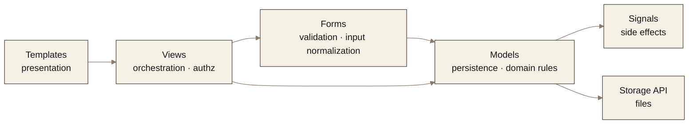
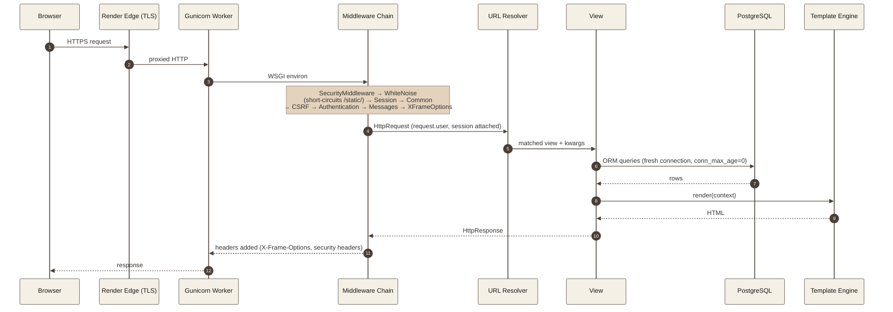
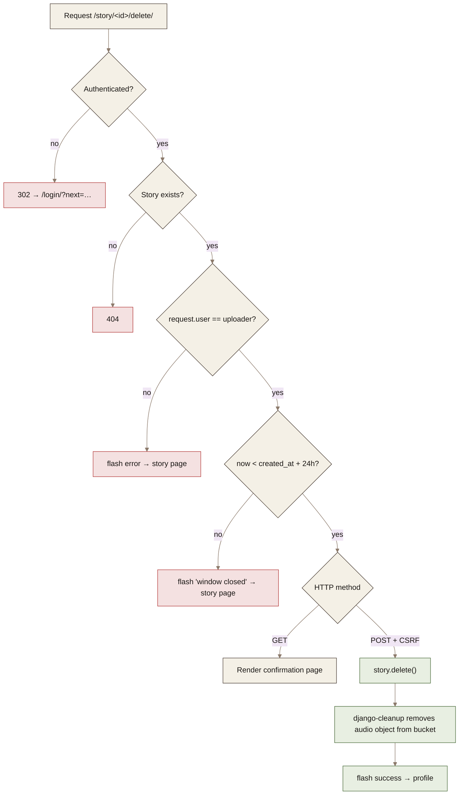
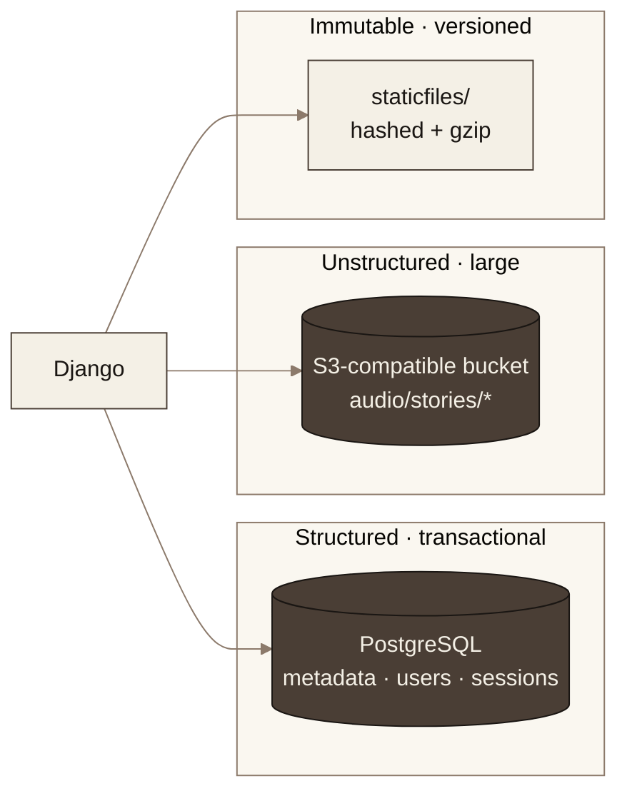
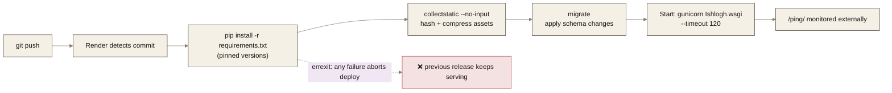

<div align="center">

# 🏛 Ishlogh — Architecture Deep-Dive

<sub>Request lifecycle · state management · storage & caching · scalability · security</sub>

[← Back to README](./README.md)

</div>

---

## Contents

1. [Architectural Style](#1-architectural-style)
2. [Codebase Topology](#2-codebase-topology)
3. [Request Lifecycle](#3-request-lifecycle)
4. [Routing Map](#4-routing-map)
5. [State Management](#5-state-management)
6. [Storage & Caching Strategy](#6-storage--caching-strategy)
7. [Configuration & Environments](#7-configuration--environments)
8. [Build & Deployment Pipeline](#8-build--deployment-pipeline)
9. [Security Model](#9-security-model)
10. [Scalability & Performance](#10-scalability--performance)
11. [Trade-offs & Future Work](#11-trade-offs--future-work)

---

## 1. Architectural Style

Ishlogh is a **server-rendered modular monolith** built on Django 4.2 LTS. This was a deliberate choice for a small, content-centric product:

| Concern | Choice | Why |
| :--- | :--- | :--- |
| Rendering | Server-side Django Templates | Fast first paint on low-bandwidth mobile networks, SEO-friendly story pages, no SPA build tooling. |
| Interactivity | Progressive enhancement with vanilla JS | Only the upload flow needs client logic; every page still works as a plain HTML form. |
| Domain | Single Django app (`folk`) | One bounded context — *stories and their contributors* — keeps the codebase cohesive. |
| Persistence | Relational DB + object storage | Structured metadata in SQL, large binaries in a bucket; each in the store best suited to it. |
| Hosting | PaaS (Render) + managed services | No servers to patch; the app is twelve-factor so the host is replaceable. |

---

## 2. Codebase Topology

High-level layout (structure only — no source shown):

```text
Ishlogh/                      ← repository root
├── Ishlogh/                  ← Django project package
│   ├── settings.py           ← env-driven config: DB, storage, auth routing, logging
│   ├── urls.py               ← root URLConf + /ping/ health check
│   ├── wsgi.py / asgi.py     ← server entry points
│   └── Procfile              ← process definition (gunicorn)
├── folk/                     ← the single domain app
│   ├── models.py             ← Story, Region, Language, UserProfile + signals
│   ├── forms.py              ← StoryForm, CustomSignupForm, ProfileUpdateForm
│   ├── views.py              ← function-based views
│   ├── urls.py               ← app routes
│   ├── admin.py              ← model registration for the Django admin
│   ├── migrations/           ← 6 migrations tracing the schema's evolution
│   ├── templates/folk/       ← 11 templates extending a shared master layout
│   └── static/folk/          ← per-page CSS, upload.js, backdrop imagery
├── build.sh                  ← Render build script
├── gunicorn.conf.py          ← worker timeout tuning
└── requirements.txt          ← pinned dependencies
```

**Layering inside `folk`:**



Domain rules sit as close to the data as possible: name canonicalization lives in `Model.save()`, the deletion window is a model property, and URL→ID extraction lives in form cleaning — so views stay thin.

---

## 3. Request Lifecycle

### 3.1 Generic request path



**Middleware ordering matters:**

- **WhiteNoise sits directly after `SecurityMiddleware`**, so static asset requests are answered before sessions, CSRF or auth are ever evaluated — static traffic never touches the database.
- **`CsrfViewMiddleware` precedes `AuthenticationMiddleware`**, rejecting forged POSTs before any user-scoped logic runs.
- **`XFrameOptionsMiddleware`** adds clickjacking protection to every response, which is important for pages that host destructive actions (delete confirmation).

### 3.2 Authenticated write path — archiving a story

| Step | Layer | What happens |
| :---: | :--- | :--- |
| 1 | Browser | `upload.js` intercepts submit, builds `FormData`, sends via XHR with progress events. |
| 2 | Gunicorn | Worker accepts a long-running request (120 s timeout instead of the 30 s default). |
| 3 | Middleware | CSRF token from the form payload is validated; session resolves `request.user`. |
| 4 | View | `@login_required` redirects anonymous users to `/login/?next=/upload/`. |
| 5 | Upload handler | Files ≤ 10 MB are buffered in memory; larger files stream to a temp file. |
| 6 | Form | Model fields validated; Region/Language validated as existing PKs; YouTube URL reduced to an ID. |
| 7 | View | `save(commit=False)` → server sets `uploader = request.user` (never trusted from client input). |
| 8 | Storage | `FileField` pushes the file to the bucket under `audio/stories/` via the S3 API. |
| 9 | ORM | Row inserted into `folk_story`. |
| 10 | Response | `302 → home`; XHR follows it, `upload.js` reads `responseURL` and navigates. |

### 3.3 Destructive path — deleting a story



---

## 4. Routing Map

| Route | View | Auth | Methods | Purpose |
| :--- | :--- | :---: | :---: | :--- |
| `/` | `home` | — | GET | Archive feed (all stories, newest first) |
| `/about/` | `about` | — | GET | Project mission |
| `/story/<id>/` | `view_story` | — | GET | Reading view with media |
| `/signup/` | `signup_view` | — | GET · POST | Registration + automatic login |
| `/login/` | Django `LoginView` | — | GET · POST | Session login (custom template) |
| `/logout/` | Django `LogoutView` | — | POST | Session logout → login page |
| `/upload/` | `upload` | ✔ | GET · POST | Archive a story |
| `/profile/` | `profile` | ✔ | GET | Contributor dashboard |
| `/profile/edit/` | `edit_profile` | ✔ | GET · POST | Edit bio |
| `/story/all/` | `story_list` | ✔ | GET | Contributor's own uploads |
| `/story/<id>/delete/` | `delete_story` | ✔ | GET · POST | Confirm & delete (owner, ≤ 24 h) |
| `/ping/` | inline view | — | GET | Health check → `"OK"` |
| `/admin/` | Django admin | staff | — | Curation of stories, regions, languages, profiles |

> The app URLConf is mounted at both `/` and `/folk/`, preserving backwards-compatible links from an earlier URL scheme while named routes (``) always resolve to the canonical root paths.

---

## 5. State Management

Ishlogh keeps **no state in the web process**. Every kind of state has an explicit home:

| State | Where it lives | Mechanism |
| :--- | :--- | :--- |
| Identity / login | PostgreSQL `django_session` table | Database-backed sessions, session cookie on the client |
| Flash messages | Cookie → session fallback | Django messages framework (`FallbackStorage`) |
| CSRF secret | Cookie + hidden form field | `CsrfViewMiddleware` double-submit validation |
| Domain data | PostgreSQL | Django ORM |
| Media binaries | Object storage bucket | `STORAGES["default"]` → `S3Storage` |
| Static assets | Build artefact on disk | `collectstatic` → WhiteNoise |
| Upload progress | Browser memory only | XHR `progress` events — never round-trips to the server |
| Derived state | Computed on read | `can_be_deleted`, distinct-region counts, story counts |

**Derived over stored.** Values like "can this story still be deleted?" or "how many regions has this contributor covered?" are computed at read time rather than persisted, eliminating a whole class of stale-flag bugs and background jobs.

**Profile lifecycle via signals.** A `post_save` receiver on `auth.User` creates the one-to-one `UserProfile` at registration, and a second receiver persists profile changes when the user is saved. Views call `get_or_create()` as a belt-and-braces fallback, so accounts created outside the signup flow self-heal on first visit.

---

## 6. Storage & Caching Strategy

### 6.1 Three-tier storage



| Asset class | Strategy | Benefit |
| :--- | :--- | :--- |
| **Static (CSS/JS/images)** | WhiteNoise `CompressedManifestStaticFilesStorage`: filenames are content-hashed at build time and pre-compressed. | Hashed names allow far-future cache headers safely; compressed variants cut transfer size; no CDN or Nginx required. |
| **Media (audio)** | `django-storages` `S3Storage` against Backblaze B2. Audio is fetched by the browser **directly from the bucket**, not proxied through Django. | Web workers aren't tied up streaming large files; survives redeploys on an ephemeral filesystem; storage is cheap and scales independently. |
| **Media URLs** | Generated by the storage backend (query-string-signed by default in `django-storages`). | The bucket can remain private while URLs expire automatically. |
| **Video** | Not stored at all — only an 11-char YouTube ID. | Zero storage/bandwidth cost for the heaviest media type. |
| **Orphans** | `django-cleanup` deletes old files when a `FileField` is cleared, replaced or its row deleted. | Prevents silent storage-cost creep. |

### 6.2 S3 compatibility layer

The storage client is configured with a custom `botocore` `Config`:

```text
request_checksum_calculation  = "when_required"
response_checksum_validation  = "when_required"
```

Newer AWS SDK versions attach additional integrity checksums to every upload by default; several S3-compatible providers do not accept these. Opting back to *when required* keeps the SDK current while remaining compatible with non-AWS object storage.

### 6.3 Environment-adaptive storage

```text
if bucket configured in environment  →  S3Storage (cloud) + WhiteNoise manifest storage
else                                 →  local MEDIA_ROOT, served by Django only when DEBUG
```

Developers can run the whole app offline with no cloud credentials, while production automatically switches to durable storage.

### 6.4 Application caching

There is intentionally **no application-level cache** (Redis/Memcached) yet: pages are cheap to render, datasets are small, and the cost/complexity of a cache tier isn't justified at the current scale. Caching is achieved where it matters most — immutable static assets and offloaded media. See [Scalability](#10-scalability--performance) for the planned path.

---

## 7. Configuration & Environments

All environment-specific values are injected via environment variables (loaded from a local `.env` during development via `python-dotenv`). **No secret is required to be in source control.**

| Variable | Purpose | Local default |
| :--- | :--- | :--- |
| `SECRET_KEY` | Cryptographic signing | Dev-only fallback |
| `DEBUG` | Debug mode toggle | `True` |
| `ALLOWED_HOSTS` | Host header allow-list (comma-separated) | `*` |
| `DATABASE_URL` | Database DSN parsed by `dj-database-url` | SQLite file |
| `B2_BUCKET_NAME` | Enables cloud media storage when present | unset → local disk |
| `B2_KEY_ID` / `B2_APPLICATION_KEY` | Bucket credentials | unset |
| `B2_ENDPOINT_URL` | S3-compatible endpoint | unset |

| Setting | Value | Reason |
| :--- | :--- | :--- |
| `conn_max_age` | `0` | A fresh DB connection per request — robust against managed/pooled Postgres providers that drop idle connections. |
| `FILE_UPLOAD_MAX_MEMORY_SIZE` | 10 MB | Typical voice notes are handled in memory; bigger files spill to disk instead of exhausting worker RAM. |
| `DATA_UPLOAD_MAX_MEMORY_SIZE` | 10 MB | Caps non-file request body size. |
| `LOGIN_URL` / `LOGIN_REDIRECT_URL` / `LOGOUT_REDIRECT_URL` | named routes | Auth routing defined once, by name, not hard-coded paths. |
| `LOGGING` | `django` errors → console | Tracebacks visible in the platform log stream with `DEBUG=False`. |
| `TIME_ZONE` / `USE_TZ` | `UTC` / `True` | Timezone-aware timestamps, which the 24-hour deletion window depends on. |

---

## 8. Build & Deployment Pipeline



- **Pinned dependencies** (`requirements.txt`) make builds reproducible.
- **Python version is pinned** (`.python-version` → 3.12) so local and production runtimes match.
- `set -o errexit` ensures a failed install, asset build or migration **fails the deploy** rather than shipping a half-migrated release.
- An external uptime monitor polls `/ping/`, which avoids free-tier cold starts and provides basic availability alerting.

---

## 9. Security Model

| Threat | Mitigation in Ishlogh |
| :--- | :--- |
| **CSRF** | `CsrfViewMiddleware` globally; every state-changing form (upload, delete, logout, profile edit, signup) carries ``; the XHR uploader sends it inside `FormData`. Logout is POST-only. |
| **Broken access control** | `@login_required` on write views; `delete_story` re-checks **ownership** and the **time window** server-side; `uploader` is assigned from `request.user`, never from form data; `story_list` is scoped to `uploader=request.user`. |
| **Mass assignment** | `ModelForm`s declare explicit `fields` allow-lists (e.g. `StoryForm` excludes `uploader`, `youtube_id`, timestamps). |
| **XSS** | Django template auto-escaping on all user content; story bodies rendered through `linebreaks` (escapes then formats); YouTube embeds built from a regex-validated ID — never from a raw user URL. |
| **Clickjacking** | `XFrameOptionsMiddleware` on all responses. |
| **SQL injection** | All data access through the Django ORM with parameterized queries. |
| **Credential storage** | Django's PBKDF2 password hashing; four password validators (similarity, minimum length, common-password list, numeric-only). |
| **Secret leakage** | Secrets injected via environment; `.env`, local DB and media directories git-ignored. |
| **Third-party tracking** | YouTube served from `youtube-nocookie.com` with a strict referrer policy and lazy loading. |
| **Content tampering** | 24-hour self-service deletion window, after which content is permanent for contributors; admin-only removal afterwards. |
| **Upload abuse / DoS** | In-memory buffering capped at 10 MB; bounded worker timeout. |

---

## 10. Scalability & Performance

### Current characteristics

- **Horizontally scalable web tier.** Because sessions live in the DB and media in object storage, adding Gunicorn workers or instances requires no sticky sessions or shared disks.
- **Static traffic bypasses Django.** WhiteNoise answers asset requests at the top of the middleware stack.
- **Media bandwidth bypasses the app.** Audio streams from the bucket to the browser directly.
- **Lean queries.** The feed template only touches `title` and `content`, avoiding N+1 relationship lookups; profile stats use DB-side `COUNT(DISTINCT …)` aggregation; "recent stories" uses a SQL `LIMIT 3` slice.
- **Small payloads.** No frontend framework; per-page stylesheets load only what each page needs; a separate, lighter backdrop image is served to mobile via a media query.

### Scaling path

| Trigger | Next step |
| :--- | :--- |
| Feed grows to hundreds of stories | Pagination / keyset pagination on `created_at` + index |
| Discovery features | PostgreSQL full-text search (`SearchVector`) on title/content, filtered by region/language |
| Read-heavy traffic | Per-view or template-fragment caching backed by Redis; CDN in front of the bucket |
| Many relationships on detail pages | `select_related('region', 'language', 'uploader')` |
| Heavy uploads | Direct-to-bucket presigned uploads from the browser, removing the app server from the upload data path entirely |
| Connection churn at scale | Enable persistent connections or an external pooler (e.g. PgBouncer) |

---

## 11. Trade-offs & Future Work

| Decision | Trade-off accepted | Revisit when |
| :--- | :--- | :--- |
| Monolith + SSR | Less "app-like" interactivity | Rich client features (offline recording, maps) are needed |
| Uploads proxied through Django | Worker occupied during transfer; needs higher timeout | Upload volume grows → presigned direct uploads |
| No cache tier | Every page hits the DB | Sustained traffic growth |
| YouTube for video | Dependency on a third-party platform | Need for self-hosted archival-grade video |
| Function-based views | Some repetition across views | Feature surface grows substantially |

**Planned:** automated test suite with CI, server-side audio type/size validation, search & filters, pagination, i18n for Urdu/Khowar UI, and a region map view.

---

<div align="center">
<sub><a href="./README.md">← Back to README</a> · This document describes architecture only; no proprietary source code is included.</sub>
</div>
