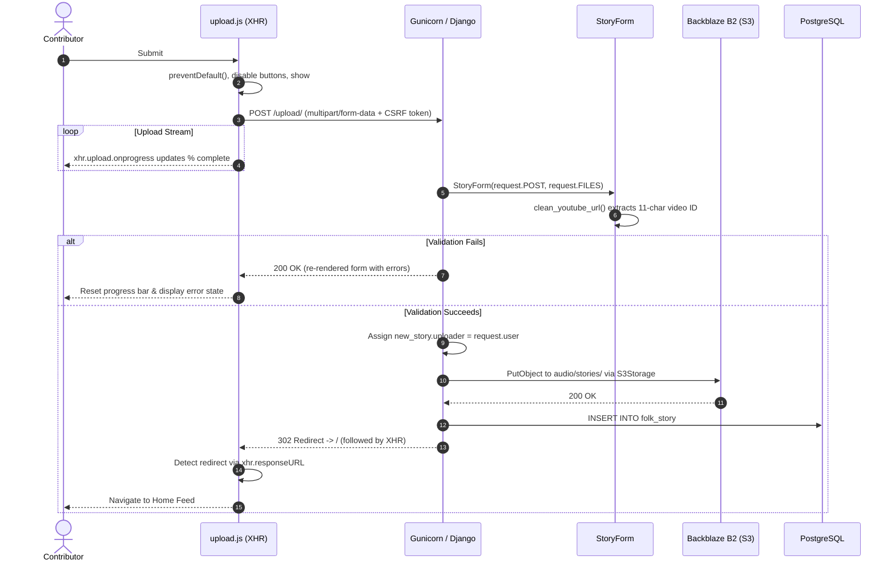
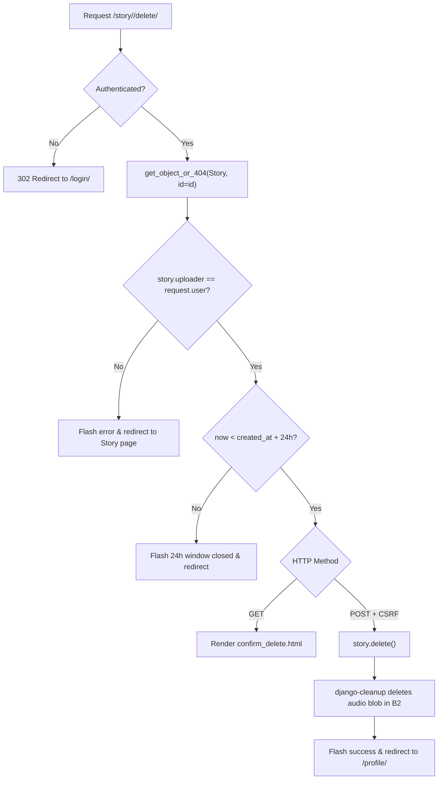

# Ishlogh — Architecture & Technical Deep-Dive

[← Back to README](./README.md)

This document breaks down the internal architecture, request lifecycle, state management, storage strategy, and security posture of **Ishlogh**.

---

## 1. Codebase Structure

Ishlogh is organized as a focused Django 4.2 monolith with a single domain app (`folk`):

```text
Ishlogh/
├── Ishlogh/                  # Project configuration package
│   ├── settings.py           # Env-driven DB, B2 storage, WhiteNoise, logging
│   ├── urls.py               # Root URL dispatcher + /ping/ health endpoint
│   ├── wsgi.py / asgi.py     # Server entrypoints
│   └── Procfile              # Gunicorn process specification
├── folk/                     # Core folklore archive application
│   ├── models.py             # Story, Region, Language, UserProfile + post_save signals
│   ├── forms.py              # StoryForm (YouTube regex parser), CustomSignupForm, ProfileUpdateForm
│   ├── views.py              # Function-based views & permission enforcement
│   ├── urls.py               # Application routes
│   ├── admin.py              # Admin registration for curation
│   ├── migrations/           # 6 sequential schema migrations
│   ├── templates/folk/       # 11 HTML templates inheriting from master.html
│   └── static/folk/          # Per-page CSS stylesheets, upload.js, responsive backdrops
├── build.sh                  # Render CI/CD build script (install -> collectstatic -> migrate)
├── gunicorn.conf.py          # Worker timeout configuration (120s)
└── requirements.txt          # Pinned production dependencies
```

---

## 2. Request Lifecycle

### 2.1 Middleware Pipeline

Every incoming HTTP request passes through an ordered 8-layer middleware stack in `Ishlogh/settings.py`:

1. **`SecurityMiddleware`** — Enforces baseline security headers.
2. **`WhiteNoiseMiddleware`** — Intercepts `/static/*` requests immediately, serving compressed, content-hashed assets without touching sessions or the database.
3. **`SessionMiddleware`** — Hydrates session state from PostgreSQL.
4. **`CommonMiddleware`** — Normalizes URLs.
5. **`CsrfViewMiddleware`** — Validates CSRF tokens on all mutating (`POST`) requests before any view executes.
6. **`AuthenticationMiddleware`** — Binds `request.user` from the active session.
7. **`MessageMiddleware`** — Manages one-time flash notifications (used for deletion and permission feedback).
8. **`XFrameOptionsMiddleware`** — Sets `X-Frame-Options` to prevent clickjacking.

### 2.2 Multi-Modal Story Upload Flow

Archiving a story with an audio recording involves coordinated work across the browser, Gunicorn, Django forms, Backblaze B2, and PostgreSQL:



### 2.3 Time-Boxed Story Deletion Flow



---

## 3. Application Routing Table

Routes are mounted at both `/` and `/folk/` in `Ishlogh/urls.py`:

| Path | View | Auth Required | Methods | Description |
| :--- | :--- | :---: | :---: | :--- |
| `/` | `views.home` | No | `GET` | Archive home feed ordered by `-created_at` |
| `/about/` | `views.about` | No | `GET` | Mission statement & cultural background |
| `/story/<int:story_id>/` | `views.view_story` | No | `GET` | Full story text, HTML5 audio player, YouTube embed |
| `/signup/` | `views.signup_view` | No | `GET`, `POST` | User registration + auto-login + signal profile creation |
| `/login/` | `LoginView` | No | `GET`, `POST` | Session authentication (`folk/login.html`) |
| `/logout/` | `LogoutView` | — | `POST` | Terminates session and redirects to `login` |
| `/upload/` | `views.upload` | Yes | `GET`, `POST` | Multipart story + audio upload |
| `/profile/` | `views.profile` | — | `GET` | Contributor bio, total stories, distinct regions count, recent 3 stories |
| `/profile/edit/` | `views.edit_profile` | Yes | `GET`, `POST` | Update contributor bio (`UserProfile`) |
| `/story/all/` | `views.story_list` | Yes | `GET` | Complete chronological list of the user's uploaded stories |
| `/story/<int:id>/delete/` | `views.delete_story` | Yes | `GET`, `POST` | 2-step deletion gated by ownership and 24h window |
| `/ping/` | `ping_view` | No | `GET` | Lightweight `"OK"` health check for uptime monitors |

---

## 4. State Management & Data Integrity

Ishlogh keeps the web tier completely **stateless**:

- **Session & Auth State:** Stored in PostgreSQL (`django.contrib.sessions`), allowing any Gunicorn worker to authenticate any request.
- **Signal-Driven Profile Provisioning:** Two `post_save` receivers on `django.contrib.auth.models.User` automatically create and save a 1:1 `UserProfile` whenever a user registers. Profile views also use `UserProfile.objects.get_or_create(user=user)` so legacy or CLI-created superusers never trigger `RelatedObjectDoesNotExist`.
- **Model-Level Canonicalization:** Both `Region.save()` and `Language.save()` normalize `self.name = self.name.title()` before writing to the database, preventing duplicate taxonomy entries caused by inconsistent capitalization.
- **Computed Domain Properties:** Rather than running a background cron job to flip a boolean flag after 24 hours, `Story.can_be_deleted` computes `timezone.now() < self.created_at + timedelta(hours=24)` dynamically using timezone-aware UTC timestamps (`USE_TZ = True`).

---

## 5. Storage & Caching Strategy

| Storage Tier | Implementation | Architectural Details |
| :--- | :--- | :--- |
| **Relational Data** | PostgreSQL (`dj-database-url`) | Configured with `conn_max_age=0` so connections close cleanly at the end of each request, preventing connection exhaustion on managed PostgreSQL tiers. Falls back to `db.sqlite3` when `DATABASE_URL` is absent. |
| **Cloud Object Storage** | Backblaze B2 (`S3Storage`) | Activated automatically when `B2_BUCKET_NAME` is present in the environment. Uses a custom `botocore.config.Config` (`request_checksum_calculation="when_required"`, `response_checksum_validation="when_required"`) for S3 API compatibility. |
| **Orphaned Media Cleanup** | `django-cleanup` | Registered in `INSTALLED_APPS` (`CleanupConfig`). Listens to model deletion and file-replacement signals to automatically remove stale audio files from Backblaze B2. |
| **Static Assets** | WhiteNoise | Uses `CompressedManifestStaticFilesStorage` in production to gzip and fingerprint CSS, JS, and backdrop images during `build.sh`, enabling long-lived browser caching without an external CDN. |
| **Upload Buffering** | Django Upload Handlers | `FILE_UPLOAD_MAX_MEMORY_SIZE` and `DATA_UPLOAD_MAX_MEMORY_SIZE` are set to `10485760` (10 MB). Uploads under 10 MB stay in memory; larger files stream from temporary disk storage to B2. |

---

## 6. Security Controls

- **CSRF Protection:** Enabled globally via `CsrfViewMiddleware`. Every form—including the asynchronous XHR upload (`FormData(form)`) and the `POST`-only logout form—transmits a CSRF token.
- **Server-Side Authorization:** `delete_story` verifies `story.uploader == request.user` and `story.can_be_deleted` on the server regardless of UI state. `upload` assigns `new_story.uploader = request.user` in the view rather than exposing `uploader` in `StoryForm.Meta.fields`.
- **XSS & Embed Hardening:** Story narratives are auto-escaped by Django templates (`{{ story.content|linebreaks }}`). YouTube links are stripped down to a regex-verified 11-character video ID (`[a-zA-Z0-9_-]{11}`) and embedded via `https://www.youtube-nocookie.com/embed/<id>` with `referrerpolicy="strict-origin-when-cross-origin"`.
- **Audio Controls:** The `<audio>` player sets `controlsList="nodownload noplaybackrate"` to discourage casual scraping of oral recordings.
- **Secret Management:** Production credentials (`SECRET_KEY`, `DATABASE_URL`, `B2_KEY_ID`, `B2_APPLICATION_KEY`, `B2_ENDPOINT_URL`) are loaded strictly from environment variables.

---

## 7. Scalability & Production Operations

- **Fail-Fast Build Pipeline (`build.sh`):** Runs with `set -o errexit`, chaining `pip install -r requirements.txt`, `python manage.py collectstatic --no-input`, and `python manage.py migrate`. Any failure halts deployment before traffic switches over.
- **Cold-Start Mitigation (`/ping/`):** Provides a zero-database-query health check endpoint returning `"OK"`, allowing external uptime monitors (such as UptimeRobot) to keep the Render web instance warm.
- **Production Error Visibility:** Custom `LOGGING` configuration streams `ERROR`-level tracebacks from the `django` logger directly to `console` (`StreamHandler`) so production 500 errors surface immediately in Render logs even when `DEBUG = False`.
- **Mobile Bandwidth Optimization:** `master.css` serves a dedicated, compressed mobile backdrop (`backdrop-m.png`) below `600px` viewport widths.
