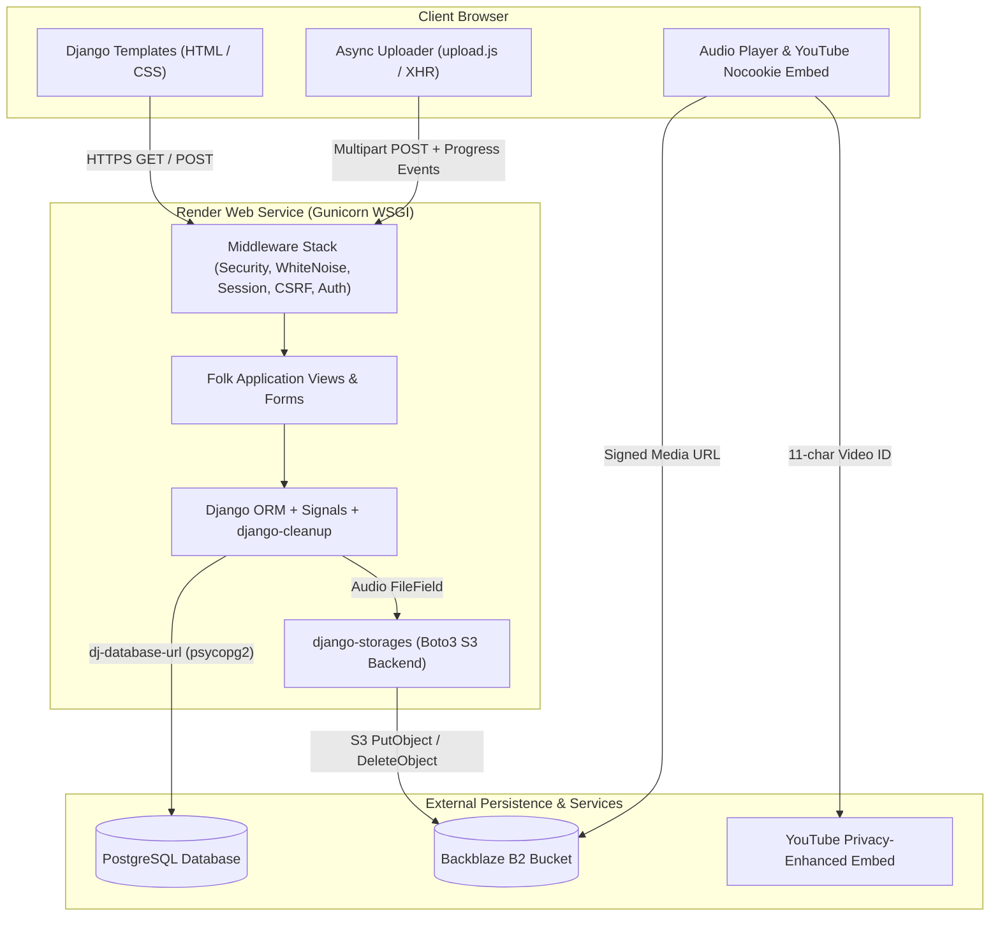
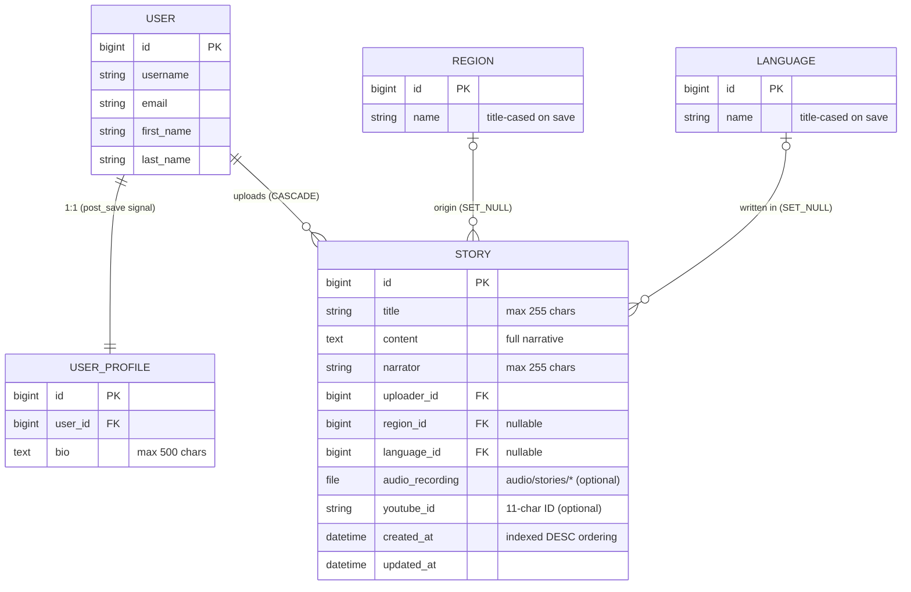

 

**A community-driven digital archive preserving regional oral folklore — myths, legends, and ancestral stories — across written text, voice recordings, and video.**

[**Live Archive**](#demo--visuals) · [**System Architecture**](#system-architecture) · [**Engineering Highlights**](#key-engineering-highlights) · [**Deep-Dive Docs**](./ARCHITECTURE.md) · [**Request Access**](#private-repository-notice)

---

## Problem & Motivation

In the mountain communities of northern Pakistan (such as Chitral and Gilgit), folklore has survived for generations almost entirely through oral transmission in regional languages like Khowar and Urdu. As elders pass on and younger generations migrate, unrecorded stories disappear permanently.

**Ishlogh** was built to solve the technical challenges of archiving endangered oral history on lean cloud infrastructure:

- **Multi-Format Preservation:** A single folk tale may exist as a written narrative, a voice recording of an elder, or a recorded video performance. Ishlogh unifies all three under a single canonical record.
- **Resilient Media Storage on Ephemeral Hosts:** Modern PaaS containers wipe local disks on every deploy and time out on slow mobile uploads. Ishlogh streams audio files to S3-compatible cloud storage (**Backblaze B2**) with asynchronous browser progress tracking and extended WSGI worker timeouts.
- **Structured Taxonomy without Data Loss:** Free-text region and language tags quickly fragment into duplicates. Ishlogh normalizes metadata into dedicated lookup models (`Region`, `Language`) with automatic title-case canonicalization and non-destructive foreign keys (`SET_NULL`).
- **Permanent Archive Integrity vs. Contributor Control:** Contributors get a strict **24-hour self-service deletion window** to fix accidental uploads, after which stories become permanent archival records.

---

## System Architecture

Ishlogh is a **stateless, server-rendered Django 4.2 monolith**. Application state lives in **PostgreSQL**, user-uploaded audio streams directly to **Backblaze B2** via the S3 API, and static assets are fingerprinted and compressed at build time by **WhiteNoise**.

> For request lifecycles, upload sequence diagrams, middleware ordering, and security controls, read **[ARCHITECTURE.md](./ARCHITECTURE.md)**.

---

## Key Engineering Highlights

### 1. S3-Compatible Cloud Media Pipeline with Botocore Checksum Tuning
Audio recordings are routed to **Backblaze B2** via `django-storages` (`S3Storage`) when cloud credentials are present in the environment, falling back automatically to local `MEDIA_ROOT` during offline development. Recent `botocore` releases inject default flexible checksum headers on `PutObject` calls that non-AWS S3 endpoints reject; Ishlogh resolves this cleanly in `settings.py` using a custom `botocore.config.Config` with `request_checksum_calculation="when_required"` and `response_checksum_validation="when_required"`. Furthermore, `django-cleanup` is wired into the model lifecycle so deleting or replacing a story automatically purges its orphaned audio blob from B2.

### 2. Progressive-Enhancement XHR Uploader with Long-Timeout Workers
Uploading multi-megabyte voice recordings over rural mobile connections often appears frozen on standard HTML forms. `upload.js` intercepts `#storyForm` submissions, packages the form and CSRF token into a `FormData` payload, and transmits it over `XMLHttpRequest`—chosen specifically over `fetch()` for its native `xhr.upload.onprogress` byte-stream events. Because XHR transparently follows Django's `302` redirect upon completion, the client compares `xhr.responseURL` against the current URL to distinguish a successful redirect from a re-rendered validation error. On the backend, Gunicorn workers are configured with a **120-second timeout** (`gunicorn.conf.py` and `Procfile`) and a **10 MB in-memory upload threshold** (`FILE_UPLOAD_MAX_MEMORY_SIZE`).

### 3. Defensive YouTube URL Sanitization & Privacy-Enhanced Playback
Rather than storing raw user-submitted URLs or embed snippets, `StoryForm.clean_youtube_url()` validates input against four regular expressions covering standard watch links (`youtube.com/watch?v=`), short links (`youtu.be/`), embeds (`youtube.com/embed/`), and Shorts (`youtube.com/shorts/`). Only the sanitized 11-character alphanumeric video ID (`[a-zA-Z0-9_-]{11}`) is persisted to `Story.youtube_id`. Templates reconstruct the player inside a sandboxed `https://www.youtube-nocookie.com/embed/<id>` iframe with `loading="lazy"` and `referrerpolicy="strict-origin-when-cross-origin"`.

### 4. Time-Boxed Deletion Window Enforced Across UI and Server
To protect the permanence of the archive while allowing contributors to fix mistakes, `Story.can_be_deleted` evaluates `timezone.now() < self.created_at + timedelta(hours=24)`. In the story template, this property controls whether the uploader sees a delete button or an archival lock notice. In `views.delete_story`, both **uploader ownership** (`story.uploader == request.user`) and **the 24-hour window** (`story.can_be_deleted`) are strictly re-verified server-side before accepting a CSRF-protected `POST` confirmation.

### 5. Normalized Taxonomy & Signal-Driven Contributor Profiles
Across six iterative schema migrations, regional and linguistic metadata evolved from free-text strings into dedicated `Region` and `Language` models that override `.save()` to enforce `.title()` casing. `Story` links to both via `on_delete=models.SET_NULL` so administrative taxonomy edits never cascade-delete stories. Contributor accounts are paired with a `UserProfile` auto-provisioned via a `post_save` signal on Django's `User` model (with `get_or_create()` fallback in profile views), powering a contributor dashboard that computes distinct regional reach via `Story.objects.filter(uploader=user).values('region').distinct().count()`.

---

## Data Model

---

## Tech Stack

| Layer | Technology | Role in Ishlogh |
| :--- | :--- | :--- |
| **Backend Framework** | Python 3.12 · Django 4.2 LTS | URL routing, ORM, session auth, CSRF protection, template rendering |
| **Database** | PostgreSQL (`psycopg2-binary`) · SQLite | Relational persistence switched automatically via `dj-database-url` |
| **Object Storage** | Backblaze B2 · `django-storages` · `boto3` | Cloud storage for voice recordings (`audio/stories/`) + `django-cleanup` |
| **Frontend** | Django Templates · Custom CSS · Vanilla JS | Responsive parchment UI, sticky glassmorphism navbar, XHR upload progress |
| **Static Assets** | WhiteNoise | `CompressedManifestStaticFilesStorage` for hashed, gzipped static files |
| **WSGI & Deployment** | Gunicorn · Render (`build.sh`) | 120s worker timeout, automated `collectstatic` + `migrate` deploy pipeline |

---

## Demo & Visuals

> **Live Deployment:** **[Visit Ishlogh Live Archive](https://your-live-url.example.com)** *(placeholder — update with live URL)*

### Interactive Walkthrough

### Application Screens

| Archive Home Feed | Story Reading & Media View |
| :---: | :---: |
|  |  |
| *Card grid of archived folklore over the Hindu Kush backdrop* | *Full text narrative with embedded audio and YouTube player* |

| Live Upload Progress | Contributor Profile Dashboard |
| :---: | :---: |
|  |  |
| *Asynchronous XHR audio upload with real-time progress bar* | *Contributor metrics: total stories, unique regions, and recent tales* |

*(See [ASSETS_CHECKLIST.md](./ASSETS_CHECKLIST.md) for instructions on capturing and dropping these visuals into `./assets/`.)*

---

## Private Repository Notice

The source code for **Ishlogh** is hosted in a private repository to safeguard production configurations, contributor data, and archival integrity. This public repository serves as an architectural showcase and technical overview.

**For Recruiters, Researchers & Collaborators:**
- **Live Codebase Walkthrough:** Happy to walk through the Django internals, migration history, and deployment setup on a call.
- **Temporary Read Access:** Available upon request for technical evaluation.
- **Cultural Preservation Collaboration:** Open to connecting with researchers documenting oral traditions and regional languages.

**Contact:** [GitHub (@Kashan-A1i)](https://github.com/Kashan-A1i) · [kashanali.mastuj@gmail.com](mailto:kashanali.mastuj@gmail.com)

---

© Kashan Ali · Built so that memory doesn't have to carry the whole weight alone.

