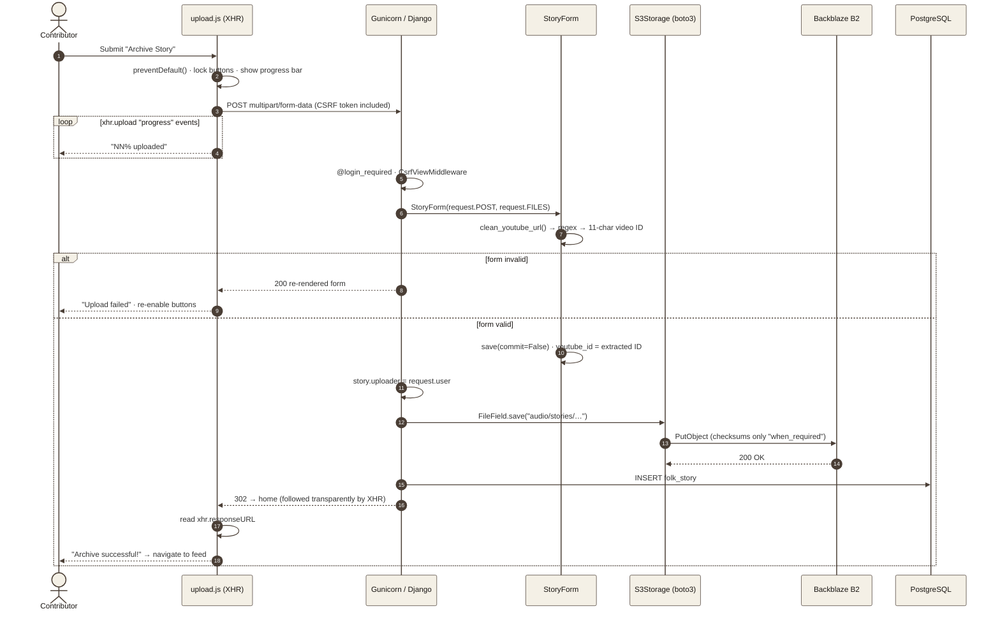
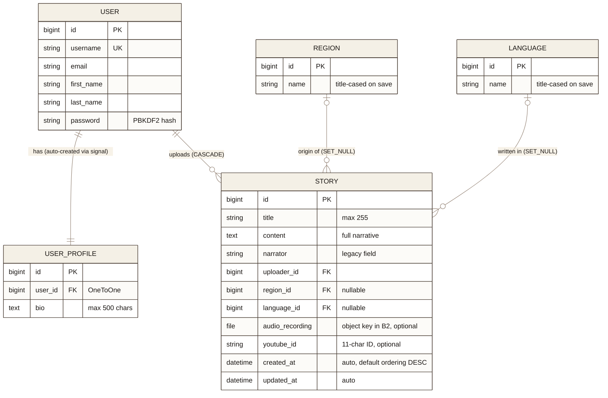

<div align="center">


### A community-driven digital archive that preserves oral folklore — ghost stories, creation myths and local legends — as searchable text, voice recordings and video before they disappear with the people who tell them.

<br/>

[](#-tech-stack)
[](#-tech-stack)
[](#-database--data-model-overview)
[](#-database--data-model-overview)
<br/>
[](#-key-engineering-highlights)
[](#-system-architecture)
[](#-demo--visuals)
[](#-key-engineering-highlights)

<br/>

[**Live Demo**](#-demo--visuals) &nbsp;·&nbsp; [**Architecture Deep-Dive**](./ARCHITECTURE.md) &nbsp;·&nbsp; [**Data Model**](#-database--data-model-overview) &nbsp;·&nbsp; [**Request Access**](#-private-repository-notice)

</div>

<br/>

> [!NOTE]
> This is a **public showcase repository**. It documents the architecture, design decisions and engineering of Ishlogh. The application source code lives in a separate private repository — see the [Private Repository Notice](#-private-repository-notice).

---

## 📑 Table of Contents

- [Problem & Motivation](#-problem--motivation)
- [Feature Overview](#-feature-overview)
- [System Architecture](#-system-architecture)
- [Key Engineering Highlights](#-key-engineering-highlights)
- [Database / Data Model Overview](#-database--data-model-overview)
- [Tech Stack](#-tech-stack)
- [Demo & Visuals](#-demo--visuals)
- [Roadmap](#-roadmap)
- [Private Repository Notice](#-private-repository-notice)

---

## 🔥 Problem & Motivation

> *"Ishlogh began around a fire, in the voice of a grandmother finishing a story just as the lamp burned low."*

In the mountain communities of northern Pakistan (Chitral, Gilgit and beyond), folklore has survived for centuries **purely through oral transmission** — in languages like Khowar that have little written literature and almost no digital footprint. Every generation that passes without recording these stories risks losing them permanently.

Building an archive for this material is a deceptively tricky engineering problem:

| Challenge | Why it's hard | How Ishlogh addresses it |
| :--- | :--- | :--- |
| **Multi-modal content** | A story may exist as text, a voice note from an elder, or a video — often all three. | A single `Story` entity carries text, an optional audio file in object storage, and an optional YouTube embed. |
| **Large uploads on modest hosting** | Audio files are big; free-tier PaaS workers time out and ephemeral disks lose files on redeploy. | Media is streamed to **S3-compatible object storage (Backblaze B2)**, Gunicorn's timeout is raised to 120 s, and the browser shows real-time upload progress. |
| **Messy, inconsistent metadata** | Contributors type "chitral", "Chitral " or "CHITRAL" for the same place. | Regions and languages are **normalized lookup tables** with automatic title-case canonicalization. |
| **Trust & content integrity** | An archive must be permanent, but contributors need a way to fix mistakes. | A **24-hour self-service deletion window**, enforced server-side, after which content becomes permanent (admin-only removal). |
| **Zero-budget operations** | A cultural-preservation project has no ops budget. | Env-driven config that runs on SQLite locally and PostgreSQL + B2 in production, deployed on Render with a health-check endpoint for uptime monitoring. |

---

## ✨ Feature Overview

<table>
<tr>
<td width="50%" valign="top">

**📖 Public Archive**
- Card-grid home feed of every archived tale, newest first
- Distraction-free reading view with preserved line breaks
- Embedded audio player and privacy-enhanced YouTube player
- Fully responsive with a dedicated mobile backdrop

</td>
<td width="50%" valign="top">

**✍️ Contributor Tools**
- Sign-up with name/email and automatic profile creation
- Upload form with live progress bar for audio files
- Paste *any* YouTube URL format — the ID is extracted automatically
- Personal dashboard: story count, distinct regions covered, recent uploads

</td>
</tr>
<tr>
<td width="50%" valign="top">

**🛡️ Integrity Controls**
- Owner-only deletion, restricted to a 24-hour grace window
- Two-step, CSRF-protected POST confirmation for destructive actions
- Orphaned media files purged automatically on delete/replace

</td>
<td width="50%" valign="top">

**⚙️ Operations**
- One-command build pipeline (install → collectstatic → migrate)
- Compressed, fingerprinted static assets served by WhiteNoise
- `/ping/` health endpoint for external uptime monitors
- Structured console error logging for the PaaS log stream

</td>
</tr>
</table>

---

## 🏛 System Architecture

Ishlogh is a **server-rendered Django monolith** with a deliberately stateless web tier: sessions and data live in PostgreSQL, binary media lives in object storage, and static assets are baked into the build. Any Gunicorn worker can serve any request.

```mermaid
%%{init: {'theme':'base', 'themeVariables': { 'fontFamily': 'Georgia, serif', 'primaryColor': '#f4f0e6', 'primaryTextColor': '#1a1613', 'primaryBorderColor': '#4a3e35', 'lineColor': '#8c7a6b', 'clusterBkg': '#faf7f0', 'clusterBorder': '#8c7a6b' }}}%%
graph TD
    subgraph CLIENT["🌐 Client (Browser)"]
        UI["Django Templates<br/>HTML + CSS"]
        XHR["upload.js<br/>XHR + progress events"]
        AUD["HTML5 Audio Player"]
        YT["youtube-nocookie iframe"]
    end

    subgraph RENDER["☁️ Render Web Service"]
        GU["Gunicorn WSGI<br/>timeout = 120s"]
        subgraph DJ["Django 4.2 Application"]
            MW["Middleware Stack<br/>Security · WhiteNoise · Session<br/>CSRF · Auth · Messages · XFrame"]
            URL["URL Router<br/>/ · /folk/ · /admin/ · /ping/"]
            V["folk Views<br/>home · upload · story · profile · delete"]
            F["Forms Layer<br/>StoryForm · CustomSignupForm<br/>ProfileUpdateForm"]
            M["ORM Models<br/>Story · Region · Language<br/>UserProfile · auth.User"]
            SIG["post_save Signal<br/>auto-create UserProfile"]
            CL["django-cleanup<br/>orphan file purge"]
            ST["STORAGES API<br/>django-storages S3Storage"]
        end
        WN["WhiteNoise<br/>Compressed Manifest<br/>Static Files"]
    end

    PG[("🐘 PostgreSQL<br/>stories · users · sessions")]
    B2[("🗄️ Backblaze B2<br/>S3-compatible bucket<br/>audio/stories/")]
    YTS["▶️ YouTube"]
    UR["⏱️ Uptime Monitor"]
    GA["📊 Google Analytics 4"]

    UI -->|HTTPS GET/POST| GU
    XHR -->|multipart POST| GU
    GU --> MW --> URL --> V
    MW -. serves /static/ .-> WN
    V --> F --> M
    M --> SIG
    M --> CL
    M -->|psycopg2 · dj-database-url| PG
    F -->|FileField upload| ST
    CL -->|delete stale objects| ST
    ST -->|boto3 S3 API| B2
    AUD -->|signed media URL| B2
    YT -->|embed by video ID| YTS
    UR -->|GET /ping/| URL
    UI -. gtag.js .-> GA

    classDef ext fill:#e3d2bc,stroke:#4a3e35,color:#1a1613
    classDef store fill:#4a3e35,stroke:#1a1613,color:#f4f0e6
    classDef hot fill:#f4f0e6,stroke:#b33939,color:#1a1613,stroke-width:2px
    class YTS,UR,GA ext
    class PG,B2 store
    class GU,V hot
```

### Upload Flow (the most complex path)



> 📐 For the full request lifecycle, middleware ordering, storage strategy and security model, see **[ARCHITECTURE.md](./ARCHITECTURE.md)**.

---

## 🧠 Key Engineering Highlights

### 1. S3-compatible object storage with a boto3 checksum compatibility fix
Media is offloaded to **Backblaze B2** through `django-storages`' `S3Storage` backend, keeping the web tier stateless and immune to Render's ephemeral filesystem. Recent `botocore` releases send new default integrity checksums on every `PutObject`, which non-AWS S3 implementations can reject — this surfaced as failing uploads in production. The fix was a targeted `botocore.config.Config` that sets `request_checksum_calculation` and `response_checksum_validation` to `"when_required"`, restoring compatibility **without pinning an outdated SDK**. Storage selection is fully env-driven: when no bucket is configured, the app transparently falls back to local `MEDIA_ROOT`, so development needs zero cloud credentials.

### 2. Real-time upload progress via progressive-enhancement XHR
A standard Django form becomes an asynchronous upload through a small vanilla-JS layer: `upload.js` intercepts submit, rebuilds the payload as `FormData` (so the CSRF token and file travel together), and streams it with `XMLHttpRequest` — chosen over `fetch()` specifically because only XHR exposes **`upload.onprogress`** events. Because XHR follows Django's post-success `302` transparently, the script inspects **`xhr.responseURL`** to tell a redirect-on-success apart from a re-rendered invalid form, then navigates accordingly. Buttons are locked during transfer to prevent duplicate submissions. On the server side, Gunicorn's worker timeout is raised to **120 s** (in both `gunicorn.conf.py` and the `Procfile`) so slow mobile connections in mountainous regions aren't killed mid-upload, and the in-memory upload threshold is set to **10 MB** before Django spills to temp files.

### 3. Defensive YouTube ingestion: store the ID, not the URL
Contributors paste links in every imaginable shape. A non-model `youtube_url` form field runs through `clean_youtube_url()`, which matches **four URL patterns** (`watch?v=`, `youtu.be/`, `/embed/`, `/shorts/`) and extracts only the strictly validated 11-character `[A-Za-z0-9_-]` video ID; anything else raises a field-level `ValidationError`. Persisting just the ID (in a `max_length=20` column) means **arbitrary user URLs never reach the rendered page** — the template constructs the embed itself from a trusted origin, using the privacy-enhanced **`youtube-nocookie.com`** domain, `loading="lazy"` and a `strict-origin-when-cross-origin` referrer policy.

### 4. Time-boxed, owner-scoped deletion with a two-step confirmation
Archives must be permanent, yet contributors need to fix mistakes. `Story.can_be_deleted` is a computed property (`now < created_at + 24h`) consumed in **two layers**: the template decides whether to render a *Delete* button or an explanatory notice, and the `delete_story` view **re-enforces** ownership *and* the time window server-side, so crafted requests can't bypass the UI. The view follows the safe GET-confirms / POST-mutates pattern behind CSRF, and uses Django's messages framework to explain rejections. Deleting a row triggers **`django-cleanup`**, which removes the associated audio object from B2 — no orphaned blobs accumulating storage cost.

### 5. Evolving the schema from free text to normalized lookup tables
The original schema stored `region` as a free-text `CharField` and kept location/language strings on the profile. A later migration introduced first-class **`Region`** and **`Language`** tables and converted `Story.region` into a foreign key, giving contributors consistent dropdowns and enabling aggregate queries. Both models override `save()` to **title-case** names, so `"chitral"` and `"Chitral"` collapse to one canonical value. Foreign keys use **`on_delete=SET_NULL`** so removing a taxonomy entry never cascades into deleting irreplaceable stories, while `Story.uploader` uses `CASCADE` to honour account deletion. The profile dashboard then computes **"regions covered"** with a single `values('region').distinct().count()` query instead of iterating in Python.

<details>
<summary><b>➕ More engineering details</b></summary>
<br/>

- **Automatic profile provisioning:** a `post_save` receiver on `auth.User` creates a `UserProfile` the moment an account is created; profile views additionally use `get_or_create()` as a self-healing fallback for accounts that pre-date the signal (e.g. superusers created via CLI).
- **Environment-driven twelve-factor config:** `SECRET_KEY`, `DEBUG`, `ALLOWED_HOSTS`, `DATABASE_URL` and storage credentials are read from the environment (with `python-dotenv` for local `.env`), and `dj-database-url` swaps SQLite ↔ PostgreSQL without code changes.
- **Free-tier-aware ops:** a dependency-free `/ping/` view returns `"OK"` for an external uptime monitor, keeping the service warm and doubling as a liveness check.
- **Fail-fast build pipeline:** `build.sh` runs `pip install → collectstatic → migrate` with `set -o errexit`, so a failed migration aborts the deploy instead of shipping a broken release.
- **Observability on PaaS:** a custom `LOGGING` config routes `django` errors to stdout, making tracebacks visible in Render's log stream even with `DEBUG=False`.
- **Legacy-safe schema evolution:** the `narrator` column is retained in the schema for historical records even after being removed from the upload UI.

</details>

---

## 🗃 Database / Data Model Overview

Four domain tables sit alongside Django's built-in `auth` and `sessions` tables. The design centres on `Story` as the aggregate root, with taxonomy tables kept separate so they can be curated by admins.



| Design decision | Rationale |
| :--- | :--- |
| `BigAutoField` primary keys | Project-wide default — avoids future integer-overflow migrations. |
| `Meta.ordering = ['-created_at']` | Newest-first feed everywhere without repeating `order_by()` in each view. |
| `SET_NULL` on taxonomy FKs | Stories are irreplaceable; deleting a region or language must never delete content. |
| Binary data **outside** the database | Only the object key is stored; audio lives in B2, keeping DB backups small and fast. |
| Normalization in `save()` | Canonical names are enforced at the model layer, so admin edits and form submissions behave identically. |

---

## 🧰 Tech Stack

| Layer | Technology |
| :--- | :--- |
| **Language / Runtime** | Python 3.12 |
| **Web Framework** | Django 4.2 LTS (function-based views, ModelForms, class-based auth views) |
| **Frontend** | Server-rendered Django Templates · hand-written CSS (glass-morphism sticky navbar, parchment design system) · vanilla JavaScript |
| **Database** | PostgreSQL (production, `psycopg2` + `dj-database-url`) · SQLite (local development) |
| **Object Storage** | Backblaze B2 via S3 API (`django-storages` + `boto3`) |
| **Static Assets** | WhiteNoise `CompressedManifestStaticFilesStorage` |
| **App Server** | Gunicorn |
| **Hosting / CI** | Render (build script: install → collectstatic → migrate) |
| **Housekeeping** | `django-cleanup` (orphan file removal) · `python-dotenv` |
| **Third-party embeds** | YouTube (privacy-enhanced mode) · Google Analytics 4 |

---

## 🎬 Demo & Visuals

<div align="center">

### 🔗 Live Deployment

**[▶ Visit Ishlogh — `https://your-live-url.example.com`](https://your-live-url.example.com)**
<br/><sub>*Hosted on a free tier — the first request may take a few seconds to wake the server.*</sub>

<br/>

### 🎥 Walkthrough


<sub>Sign up → archive a story with audio (live progress bar) → read it with embedded media → view contributor dashboard.</sub>

</div>

<br/>

### 📸 Screenshots

| Archive Home Feed | Story Reading View |
| :---: | :---: |
|  |  |
| *Card grid of archived tales over the mountain backdrop* | *Full narrative with audio player & YouTube embed* |

| Upload with Live Progress | Contributor Dashboard |
| :---: | :---: |
|  |  |
| *Real-time XHR upload progress to object storage* | *Stories count, regions covered & recent uploads* |

<details>
<summary><b>📱 Mobile view</b></summary>
<br/>
<div align="center">

</div>
</details>

---

## 🗺 Roadmap

- [ ] Full-text search and filtering by region and language
- [ ] Pagination / infinite scroll for the home feed
- [ ] Server-side audio MIME-type and size validation
- [ ] Automated test suite (model, form and view tests) with CI
- [ ] Multilingual UI (Urdu / Khowar) via Django i18n
- [ ] Interactive map of stories by region

---

## 🔒 Private Repository Notice

<table>
<tr>
<td>

The source code for **Ishlogh** is maintained in a **private repository** to protect the integrity of the live archive, its contributors' data and its deployment configuration. This showcase repository contains only documentation, diagrams and visuals — no application code, credentials or data.

I'm happy to share more. **Recruiters, researchers and potential collaborators** are welcome to:

- 🎙️ **Request a live walkthrough** of the codebase and architecture over a call
- 🔑 **Request temporary read-only access** to the private repository for evaluation
- 🤝 **Discuss collaboration** on digital preservation of endangered languages and oral traditions

📬 **Get in touch:** open an issue in this repository, or reach out via my [GitHub profile](https://github.com/Kashan-A1i) · ✉️ [kashanali.mastuj@gmail.com](mailto:kashanali.mastuj@gmail.com)

</td>
</tr>
</table>

<div align="center">
<br/>
<sub>Built with care to keep the stories alive — <i>so that memory doesn't have to carry the whole weight alone.</i></sub>
<br/><br/>
<sub>© Kashan Ali · All rights reserved · Documentation in this repository may be shared with attribution.</sub>
</div>
